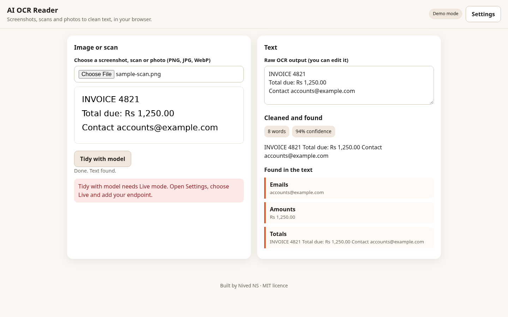

# AI OCR Reader

Read text from screenshots, scans and photos, in your browser.



## What it does
Choose an image and the app reads its text in the browser using a vendored Tesseract build (no CDN, no upload anywhere). It then tidies line breaks, rebuilds paragraphs and pulls out emails, phone numbers, links, dates, amounts and totals. A confidence score flags weak reads. Live mode can ask your own OpenAI-compatible model to clean the text further.

## Features
- Offline OCR with a vendored English model
- Clean-up of hyphenated and wrapped lines
- Emails, phone numbers, links, dates, amounts and totals extracted from the text
- Confidence score with a low-confidence warning
- Editable raw text

## Quick start
Open `index.html` directly, or serve the folder:

```bash
python3 -m http.server 8000
# then open http://localhost:8000
```

## Demo mode and live mode
- **Demo mode (default):** fully offline and deterministic. Every feature works with no key.
- **Live mode:** click **Settings**, choose *Live*, and enter an OpenAI-compatible base URL, API key and model. Your key is kept only in this browser's localStorage. It is never committed and never sent anywhere except the endpoint you enter.

Code layout: `src/core/` is pure logic with no DOM. `src/ui/` and `src/app.js` are the browser UI.

## Tests
```bash
npm test                      # node --test unit tests (65 tests)
pip install playwright && playwright install chromium
python3 tests/e2e/e2e.py      # Playwright smoke at 390x844 and 1440x900, demo + mocked live
```
The e2e script checks: no console errors, no horizontal scroll, demo mode makes no network calls, live mode uses a mocked endpoint.

## Limitations
Tesseract is an OCR engine; it reads printed text well and handwriting poorly. The cleanup is rule-based in demo mode; live mode is optional.

## Licence and credit
MIT licence, Copyright (c) 2026 Nived NS. See LICENSE.

Created and owned by Nived NS - https://github.com/connectnived-lab
